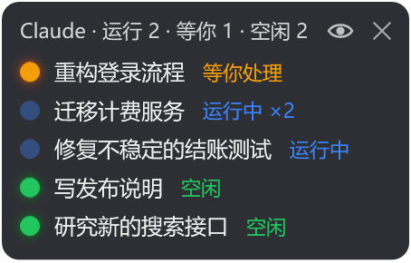
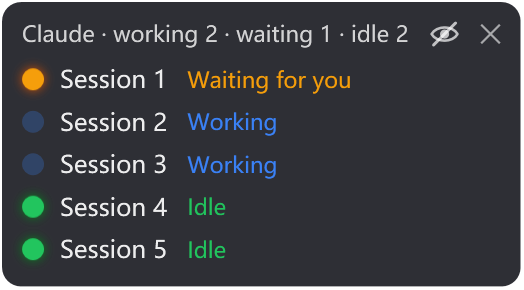

# Claude 会话状态指示灯

[English](README.md)

一个置顶的 Windows 小窗：每个正在运行的 **Claude Code** 会话一盏灯。适合在 Claude 桌面版里同时开好几个会话的人，一眼就能看出哪个在等你。

- 🔵 **运行中**（呼吸闪） · 🟡 **等你处理** · 🟢 **空闲** · ⚪ **已中断**（运行中的会话突然消失）
- 状态本身不需要 hooks：直接读 Claude Code 自己写的 `~/.claude/sessions/<pid>.json`。
- 对 Claude 只读：不往 `~/.claude` 下写任何东西，也不碰 Claude 的进程。



隐藏会话名（适合共享屏幕时用）：



## 功能

- **补上 Claude Code 自己不报的「等你」**：回合以提问结束时，Claude Code 只记成 `idle`。指示灯会读对话记录末尾，遇到未回答的 `AskUserQuestion`、等待批准的计划（`ExitPlanMode`）、收尾时提的问题、或最后一行以 `?` / `？` 结尾，就显示为「等你处理」，悬停可看问题原文。
- **认得子代理**：回合结束但后台子代理还在写记录的会话，显示「运行中 ×N」，不显示空闲。
- **提醒不扰人**：会话进入「等你处理」满 4 秒后，那一行和窗口边框闪 3 下、响一声系统提示音；同一个问题只提醒一次。
- **未读红点**：刚跑完一轮的会话会出现红点，点一下那一行消掉。
- **点一行打开会话**：把 Claude 拉到最前，并通过 UI 自动化在侧栏点开这个会话；分屏时不切换。
- **隐私**：可以隐藏全部会话名（标题栏的眼睛），也可以只隐藏某一个（鼠标移到那一行，点行尾的小眼睛，或右键）。隐藏后问题原文和当前动作也不显示。
- **托盘图标**：颜色是最紧急的状态；✕ 收进托盘。
- **轻量**：工作集约 50 MB，会话在跑时占一个核的百分之几。
- **中英文界面**，按系统语言自动选择。

## 环境要求

- Windows 10 或 11
- Windows PowerShell 5.1（系统自带）
- Claude Code（桌面版 Code 标签页或命令行），会写 `~/.claude/sessions/<pid>.json` 的版本

## 安装

1. 把 `session-lights.ps1` 和 `start-session-lights.vbs` 放到同一个文件夹，例如 `%USERPROFILE%\Tools\session-lights`。**不要**放在 `~/.claude` 里面。
2. 双击 `start-session-lights.vbs` 启动（没有黑色控制台窗口）。
3. 可选，随 Claude 一起启动：在你自己的 `~/.claude/settings.json` 里加一个 `SessionStart` hook：

   ```json
   {
     "hooks": {
       "SessionStart": [
         { "hooks": [ { "type": "command", "command": "wscript.exe \"C:/Users/<你>/Tools/session-lights/start-session-lights.vbs\"" } ] }
       ]
     }
   }
   ```

   同一时间只会运行一个；Claude 退出约一分钟后，指示灯自己关闭。

## 使用

| 操作 | 方法 |
|---|---|
| 移动 | 按住窗口任意位置拖动 |
| 在 Claude 里打开会话 | 点那一行 |
| 隐藏全部会话名 | 标题栏的眼睛，或右键 / 托盘菜单 |
| 只隐藏一个会话名 | 鼠标移到那一行点小眼睛，或在那一行上右键 |
| 只显示灯 | 右键 →「只显示灯」 |
| 提示音开关 | 右键或托盘菜单 |
| 收进托盘 / 再显示 | ✕ / 左键点托盘图标 |
| 退出 | 右键或托盘菜单 →「退出」 |

命令行：

```powershell
powershell -NoProfile -File session-lights.ps1 -Restart   # 正常重启
powershell -NoProfile -File session-lights.ps1 -Stop      # 正常退出（会移除托盘图标）
powershell -NoProfile -File session-lights.ps1 -Probe     # 打印每个会话的判定结果，不开窗口
```

## 设置

第一次使用后，脚本旁边会生成 `settings.json`：

| 键 | 含义 |
|---|---|
| `lang` | `auto`（默认）、`zh` 或 `en` |
| `mainDir` | 你常用的项目文件夹；会话在别的文件夹时，悬停提示里才显示路径 |
| `hideNames`、`hiddenSessions` | 隐藏全部会话名 / 单独隐藏的会话 |
| `compact`、`sound`、`hidden`、`left`、`top` | 只显示灯、提示音、收进托盘、窗口位置 |

## 原理

- 每 2 秒读一次 `~/.claude/sessions/*.json`（`status`：`busy` / `waiting` / `idle`），并用 `procStart` 核对每个 `pid` 还是不是原来那个进程。
- 空闲和等待中的会话，会读 `~/.claude/projects/` 里对话记录的末尾，找出待回答的问题和它的编号；运行中的会话显示最近一次工具调用。
- 所有读取都允许共享，Claude 随时可以改写自己的文件。

## 局限

- `~/.claude/sessions/*.json` 是 Claude Code 的内部文件，没有公开的格式说明，以后的版本可能会变。
- 不装 hooks 的话，分不出「正在压缩上下文」和「运行中」。
- 打开会话依赖桌面版侧栏的界面结构，界面改版后可能失效；本地 Code 标签页会话没有深链接。
- 只支持 Windows。

## 许可证

[MIT](LICENSE)
